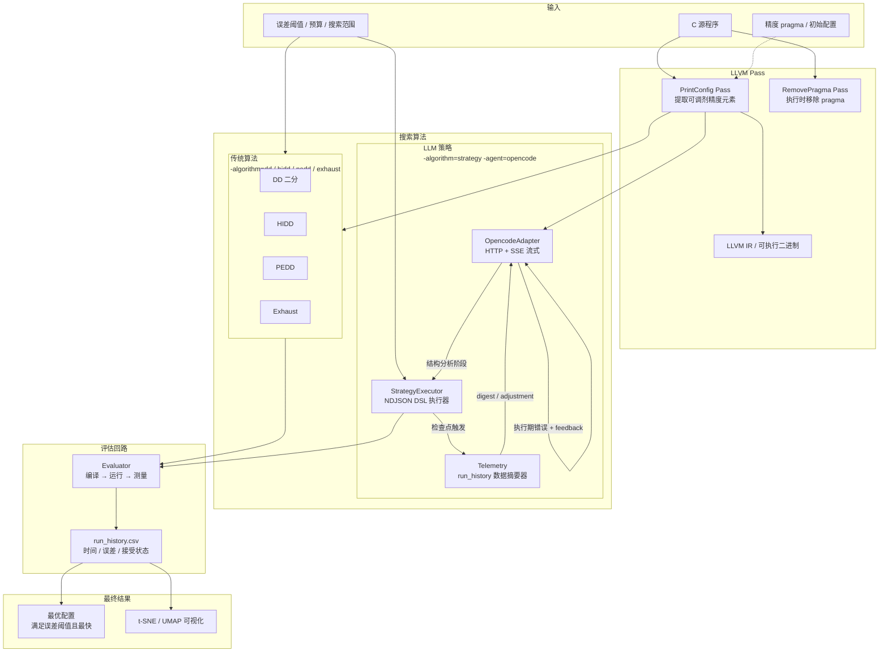
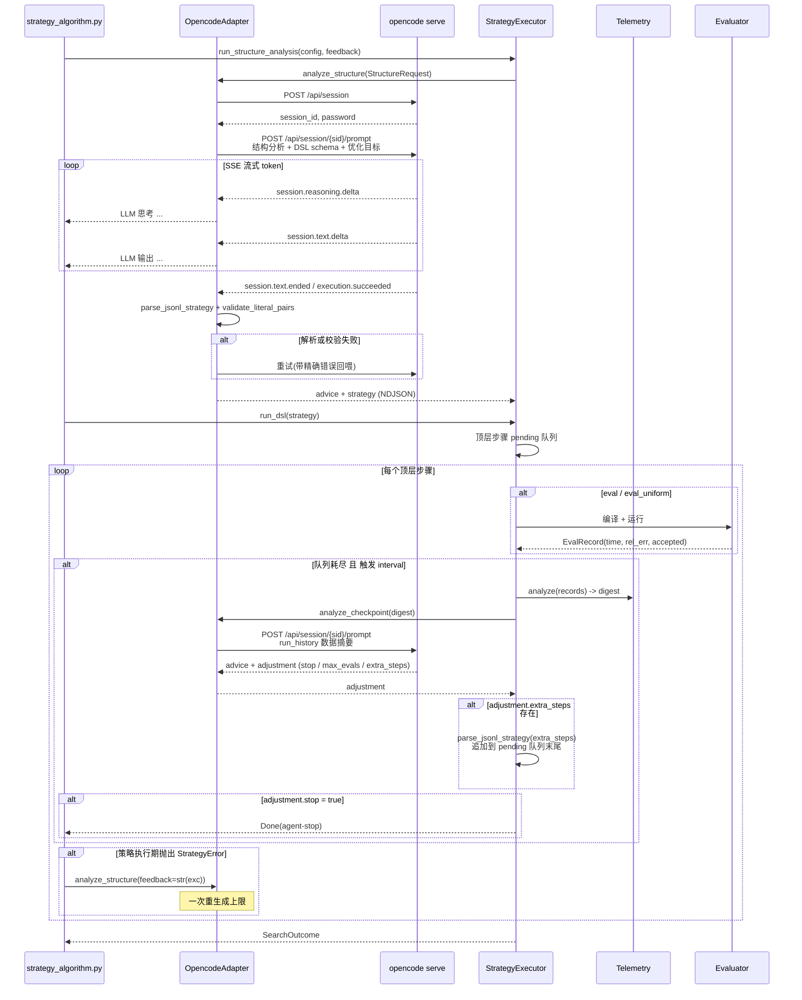

# Perci-Tuner

Perci-Tuner increases C program's runtime speed while keeping errors within an acceptable range, by reducing floating-point variables & C-Math function calls' precision.

## Architecture



### LLM Agent 内部时序



### NDJSON DSL（Tier A JSON 步骤）

LLM 输出的策略是**逐行 JSON 对象**，无闭合段，避免自回归生成时花括号提前闭合。顶层执行用 pending 队列，允许检查点通过 `adjustment.extra_steps` 动态追加步骤。块结构用显式 `end` 行配对：

```
{"advice": "结构分析结论"}
{"op": "eval_uniform", "type": "float", "as": "all_float"}
{"op": "foreach", "items": "[e for e in element_ids()]", "as": "e"}
{"op": "if", "when": "not all_float['accepted']"}
{"op": "eval", "base": "original", "pairs": "[[e, 'float']]", "as": "t"}
{"op": "end"}
{"op": "done", "reason": "收敛"}
```

| op | 说明 |
|---|---|
| `eval` / `eval_uniform` | 评估配置，结果存入变量 |
| `set` | 定义变量（支持 Python 受限表达式） |
| `foreach` / `for` / `while` | 循环 |
| `if` / `else` / `end` | 条件块（必须显式闭合） |
| `log` / `break` / `done` | 辅助 |

表达式可用：`element_ids()`、`types_of(e)`、`history`、`best`、`baseline`、`evals`、`improvement_age()`、`threshold` 等。精度只能从原始降级；`types_of(e)[0]` 是**最低精度**（通常 `__fp16`），想降 float 请用字面量 `"float"`。

## LLVM
Availability on LLVM 22.1.8 & LLVM 17.0.6 have been tested.
```sh
git clone https://github.com/llvm/llvm-project.git
cd llvm-project
git checkout llvmorg-22.1.8

cmake -G Ninja \
  -S llvm -B build \
  -DCMAKE_BUILD_TYPE=Release \
  -DLLVM_TARGETS_TO_BUILD="host" \
  -DLLVM_ENABLE_PROJECTS="clang;mlir" \
  -DCMAKE_EXPORT_COMPILE_COMMANDS=ON \
  -DLLVM_BUILD_UTILS=ON \
  -DLLVM_BUILD_TOOLS=ON \
  -DBUILD_SHARED_LIBS=ON \
  -DLLVM_ENABLE_ASSERTIONS=OFF

cmake --build build
cmake --install build --prefix ${INSTALLDIR}
```
If you want to use -mxp option, install mxp version of LLVM from gitmodule.

## Run

```sh
export PERCI_TUNER="/path/to/perci-tuner/"
sh scripts/run.sh <print-config|change-by-config|search-optimize|check> src_files [Optional Flags]
```
Check run.sh for more help info.

## Test

```sh
cd $PERCI_TUNER
sh scripts/run.sh check
```
Or run specific test:
```sh
python3 -m lit -v test/xxx
```

## Visualize search

After finishing a search, generate t-SNE & UMAP visualization and `run_history.png` with:
```bash
python3 scripts/visualize.py
```
The PNG generated from `run_history.csv`: 
* Each pie is a runned config marked with `run_id`
* Each line is a generation of configs, they were born in a common parent.
* `parent` means the run_id that current config search from
* Outer cycle means bitwidth of elements:
```
16-green, 32-blue, 64-yellow, 128-red
```
* Inner cycle means run status: 
```
Black: RUNTIME-ERROR (unexpected)
Red: out-of-errorthreshold
Yellow: Run slower than original
Green: Run faster than original
✅: The fastest config until current
```